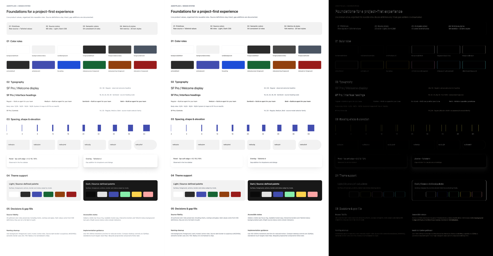
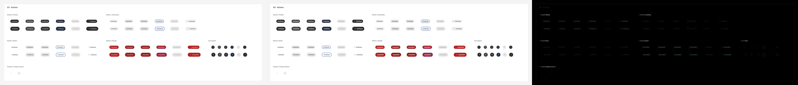
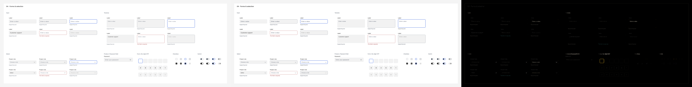
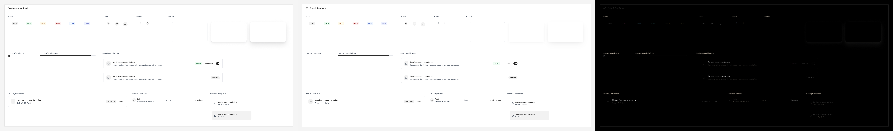
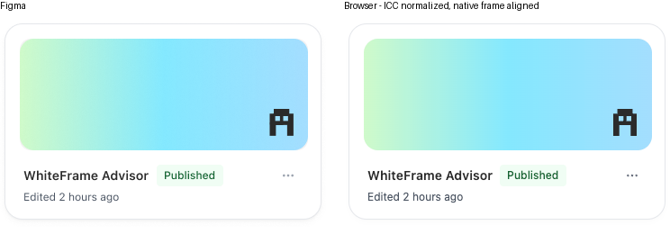
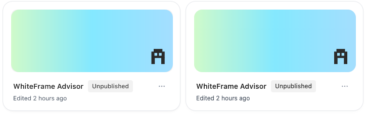
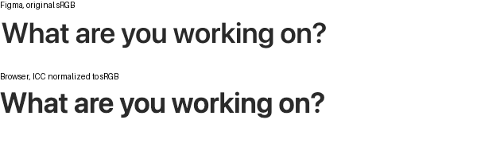

# Agentplace Storybook review evidence

This folder preserves the Figma-linked source coverage, measured browser geometry, actual interaction outcomes, motion observations and representative comparisons. It separates structural completeness from literal pixel identity. [Final full-worktree signoff](final-signoff.json) records passing Biome, all-workspace TypeScript, source audit, application build, and static Storybook build, plus current in-scope source hashes. This is source-level implementation/review signoff; literal pixel identity is not certified.

The signoff and 24-play inventory below describe the original review snapshot. The subsequent [project-cover mascot fix](project-cover-mascot-motion.md) records the disabled cover animation and Chromium eyelid rounding defect, their corrections, and the additional executed regression play. Earlier motion-clock results establish synchronization, not visible blinking.

## Recorded results

| Check                        | Evidence                                                           | Result                                                                                        |
| ---------------------------- | ------------------------------------------------------------------ | --------------------------------------------------------------------------------------------- |
| Canonical source mapping     | [Coverage manifest](../storybook-coverage.json)                    | 97/97 masters; 169/169 authored variants                                                      |
| Canonical variant bounds     | [All variant measurements](canonical-variant-geometry.json)        | 169/169 authored variants have passing expected/actual outer-bound comparisons                |
| Shared foundation values     | [Browser checks](foundation-browser-checks.json)                   | 395 variables × 2 modes = 790 comparisons; zero mismatches                                    |
| Named typography             | [Browser checks](foundation-browser-checks.json)                   | All 25 size/line-height/weight checks pass with actual SF Pro loaded                          |
| Controls/forms/data geometry | [122 measured nodes](controls-geometry.json)                       | 122 pass within 0.02px; actual/expected bounds retained                                       |
| Root geometry and icon sizes | [118 recorded cases](root-geometry.json)                           | 118 recorded pass outcomes; includes 20px and 16px icon checks                                |
| Composition representatives  | [21 measured rows](composition-geometry.json)                      | Final dimensions retained; these rows alone are not the full 34-variant expected/actual check |
| All composition variants     | [34 source-backed measurements](composition-variant-geometry.json) | 34 pass; zero missing source or failed bounds; actual SF Pro loaded in every case             |
| Controls interactions        | [Actual outcomes](controls-interactions.json)                      | 11 PASS                                                                                       |
| Composition interactions     | [Actual outcomes and steps](composition-interactions.json)         | 11 PASS                                                                                       |
| Cancellation and dialog      | [Actual outcomes](root-interactions.json)                          | 2 PASS                                                                                        |
| Press spring                 | [Measured hit box and transform](controls-press-spring.json)       | Outer hit box remains 85 × 32 while visual content scales                                     |
| Shared working-motion clock  | [Latest cohort audit](motion-shared-cohort.json)                   | Seven tracks; 0ms start/current-time deltas for canonical 2000ms and native 6800ms cohorts    |

The 24 authored play results are 11 controls, 11 compositions and two root recipes. A PASS here is a recorded executed play result, not an inference from the existence of a `play` function. Source mapping alone does not prove rendered fidelity.

The final project card is **352 × 218**. The earlier 216px-height claim was withdrawn. Preview source borders and the measured 1px text baseline refinement are represented by the final captures.

The last source gap, Unpublished project card `49:1674`, is resolved with the [user-provided current Figma SVG](references/project-card-unpublished-source.svg). Its SHA-256 is `88eed98e67e9180fdf7938963a1775426e5f9a5e3d62c507734ac9209476cec4`. The SVG root is 362 × 228 including shadow padding; its outer card path is 352 × 218. [The source review](project-card-unpublished-review.json) records passing card/cover/status bounds and matching title/status/edited-text raster alignment at dx=0/dy=0, with nonzero antialiasing residual. This file is retained only as review evidence; the component remains native React/CSS. The combined bounds inventory resolves actual Storybook IDs using Storybook's own helpers and links every canonical variant to its recorded comparison. Passing outer bounds does not certify every content pixel or interaction.

## Motion scope

The newest [shared-cohort artifact](motion-shared-cohort.json) supersedes the pre-fix working-track timing. It records equal shared clocks, offscreen pause at a held phase, synchronized resume, cancellation cleanup, zero animations in reduced mode, and aligned restart after both cancellation and preference changes.

[Historical lifecycle/keyframe captures](motion-lifecycle-pre-cohort-fix.json) retain earlier seeked native/ambient samples. Their pre-fix 50–90ms working-track drift is historical and must not be presented as current behavior. Ambient samples at 0/8/16/24/32 seconds are seeked samples; they are not a recorded 32-second wall-clock cycle. A complete live 6800ms native-artwork loop and a real `document.hidden` transition were not observed. Those limits remain explicit.

## Color-managed comparisons

Every quantitative comparison below uses sRGB. Embedded browser ICC profiles were converted before measuring; untagged Figma references and previously normalized sheets are treated as sRGB. Alpha is composited on white. The value is mean absolute RGB channel difference on a 0–255 scale. It is not converted into a “percent accurate” score.

Comparison images use **Figma / Storybook / absolute difference** columns, except the supplied project-card and title comparisons, which retain their original labeled layout. Full-board averages include empty backgrounds and can hide local text differences; [per-component crop metrics](controls-component-pixels.json) are preserved as well.

| Source                                                                                                             | Mean absolute RGB difference | Comparison                                    |
| ------------------------------------------------------------------------------------------------------------------ | ---------------------------: | --------------------------------------------- |
| [30:2](https://www.figma.com/design/m0v1MINOJA152Kil6JHeZ8/Agentplace?node-id=30-2) · Foundations overview         |                       1.8616 | [Open image](comparisons/foundations.png)     |
| [210:1970](https://www.figma.com/design/m0v1MINOJA152Kil6JHeZ8/Agentplace?node-id=210-1970) · Actions family board |                       0.6914 | [Open image](comparisons/actions.png)         |
| [210:1978](https://www.figma.com/design/m0v1MINOJA152Kil6JHeZ8/Agentplace?node-id=210-1978) · Forms family board   |                       0.6171 | [Open image](comparisons/forms.png)           |
| [210:2012](https://www.figma.com/design/m0v1MINOJA152Kil6JHeZ8/Agentplace?node-id=210-2012) · Data family board    |                       0.6935 | [Open image](comparisons/data.png)            |
| [45:567](https://www.figma.com/design/m0v1MINOJA152Kil6JHeZ8/Agentplace?node-id=45-567) · logo-fixed               |                       5.6046 | [Open image](comparisons/logo-fixed.png)      |
| [169:1867](https://www.figma.com/design/m0v1MINOJA152Kil6JHeZ8/Agentplace?node-id=169-1867) · working-reduced      |                       2.1504 | [Open image](comparisons/working-reduced.png) |
| [237:1981](https://www.figma.com/design/m0v1MINOJA152Kil6JHeZ8/Agentplace?node-id=237-1981) · ambient-still        |                       1.2923 | [Open image](comparisons/ambient-still.png)   |

These comparisons leave nonzero font rasterization, antialiasing, layout-quantization and shadow residuals. They support visual review without certifying that every pixel is identical. Animated loading/mascot states can also differ by sampled phase; motion and static geometry are reviewed separately.

### Representative images















Additional final captures: [agent preview](renders/agent-preview-final.png), [chat composer](renders/chat-composer-final.png), [new-project prompt](renders/new-project-prompt-final.png), [project card](renders/project-card-final.png).

## Reproduce the inventory and collation

```sh
bun run scripts/audit-storybook-coverage.ts --write
uv run --with pillow python scripts/collate-storybook-review.py --source-dir /tmp
bunx biome format --write docs/storybook-review
```

The first command derives coverage from the actual exported story AST and exact Figma IDs. The second collates already captured local browser/PNG inputs; it does not execute new browser checks. [results.json](results.json) records source hashes and exact scopes, and the copied JSON files preserve the observed values.

For a fresh collation, pass `--unpublished-svg '/path/to/Status=Unpublished.svg'` or supply that exact export as `/tmp/ap-project-card-unpublished-source.svg`. The captured composition rows retain the independently verified source-file hashes.

No proprietary font binary is included. The original SF Pro face is provisioned locally for the authorized design review; see [font setup and license boundaries](../storybook-fonts.md). Do not publish a static Storybook font directory simply because its source file is ignored in Git. Raw handoff artifacts and their original manifest remain unchanged.

## Final aggregate checks

The root reviewer ran `bun run check`, `bun run check-types`, `bun run audit:storybook`, `bun run build`, and `bun run build-storybook`; all exited successfully. The complete source play inventory was matched with the executed outcomes using Storybook’s own ID helpers: 24 expected, 24 unique passes, zero missing. The saved [manual documentation/theme/touch check](docs-theme-touch.json) confirms a visible Figma source link and controls table, a dark portal inheriting the document theme, viewport collision bounds, and an explicit cover-edit action without horizontal overflow at 390px. It is not a full mobile-product certification.

`results.json` summarizes this captured review. Rerunning the collation script starts a fresh review and intentionally restores pending root checks; it does not rerun the browser or automatically renew this signoff. Compare `final-signoff.json` source fingerprints with the worktree before reusing the recorded results after edits.
